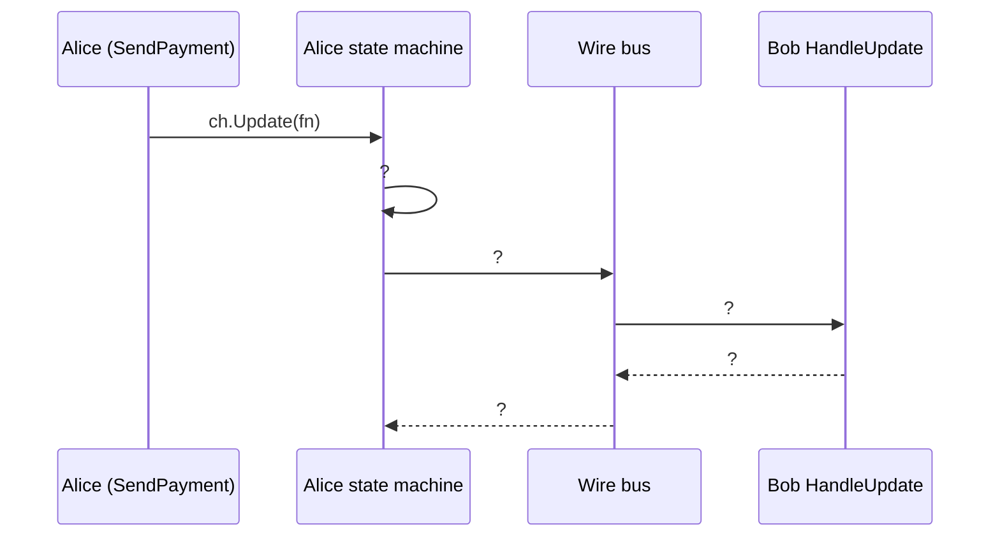

# Lab 03 — Mổ xẻ kiến trúc client

## Mục tiêu
- Hiểu từng thành phần mà `client.New(...)` cần, và vì sao.
- Vẽ được luồng dữ liệu từ lúc gọi `SendPayment` đến khi phía bên kia chấp nhận.

Lab này chủ yếu là đọc code. Không cần chạy chain.

## Các file cần đọc
| File | Nội dung chính |
|---|---|
| `payment-channel/client/client.go` | `SetupPaymentClient`, `OpenChannel`, `startWatching` |
| `payment-channel/client/handle.go` | `HandleProposal`, `HandleUpdate`, `HandleAdjudicatorEvent` |
| `payment-channel/client/channel.go` | `SendPayment`, `Settle` |
| `payment-channel/util.go` | `deployContracts`, `setupBusWire` |

## Các bước

### 1. Lập bảng thành phần
Đọc `SetupPaymentClient` và điền bảng:

| Thành phần | Dòng code tạo ra nó | Nó nói chuyện với ai? | Vai trò |
|---|---|---|---|
| Contract backend | `CreateContractBackend(...)` | ? | ? |
| Funder | `ethchannel.NewFunder(cb)` | ? | ? |
| Depositor | `ethchannel.NewETHDepositor(50000)` | ? | ? |
| Adjudicator | `ethchannel.NewAdjudicator(...)` | ? | ? |
| Watcher | `local.NewWatcher(adj)` | ? | ? |
| Wire bus | tham số `bus` | ? | ? |
| Wallet | tham số `w` | ? | ? |

### 2. Tìm hai "tay cầm" của client
Dòng `go perunClient.Handle(c, c)` truyền `c` hai lần. Mở go-perun và tìm hai interface tương ứng:
```sh
cd $(go env GOMODCACHE)/perun.network/go-perun@v0.15.0
grep -n "ProposalHandler interface" -A5 client/proposal.go
grep -n "UpdateHandler interface" -A5 client/update.go
grep -n "AdjudicatorEventHandler interface" -A5 client/adjudicate.go
```

### 3. Vẽ sequence diagram cho một lần thanh toán
Dùng Mermaid hoặc vẽ tay. Gợi ý khung:

Để điền đúng, đọc `client/update.go` trong go-perun, hàm `Update`.

### 4. Đọc các phase của kênh
```sh
grep -n "Phase = iota" -A15 channel/machine.go
```
Liệt kê các phase và đánh dấu phase nào cần giao dịch on-chain.

## Bài tập
1. Hoàn thành bảng ở bước 1.
2. Hoàn thành sequence diagram ở bước 3 và lưu vào `workspace/notes/lab03_sequence.md`.
3. `challengeDuration := uint64(10)` nằm trong `OpenChannel`. Viết 2–3 câu giải thích giá trị này dùng khi nào, và vì sao production phải dùng giá trị lớn hơn nhiều.

## Câu hỏi kiểm tra
1. Watcher chạy ở đâu? Nếu Alice tắt máy thì watcher của Alice còn bảo vệ Alice không?
2. Vì sao Funder cần biết asset (`RegisterAsset`) trước khi mở kênh?
3. Wire bus truyền những loại message nào? Có message nào lên blockchain không?

<details>
<summary>Gợi ý đáp án</summary>

- **Contract backend:** kết nối node Ethereum và ký giao dịch.
- **Funder:** nạp tiền vào AssetHolder khi mở kênh.
- **Adjudicator:** gọi contract để register, progress, conclude và withdraw.
- **Watcher:** theo dõi event on-chain và tự phản đối nếu ai đó register state cũ.
- **Bus:** chuyển message off-chain như proposal, update và chữ ký.
- **Wallet:** ký state và giao dịch.

1. `local.NewWatcher` chạy **trong tiến trình của chính client**. Alice tắt máy thì watcher cũng tắt. Vì vậy cần challenge duration đủ dài để Alice kịp quay lại, hoặc dùng watcher từ xa.
2. Funder cần biết contract nào giữ asset đó và dùng depositor nào để chuyển tiền vào.
3. Bus chỉ mang message off-chain: channel proposal, accept/reject, update, chữ ký. Không message nào trong số đó lên chain.
3. Bài tập 3: challenge duration là thời gian để phía kia phản đối khi có người register một state lên chain. 10 giây chỉ đủ cho demo. Thực tế cần hàng giờ đến hàng ngày, để bên bị gian lận kịp online và nộp state mới hơn.
</details>

## Checklist
- [ ] Bảng thành phần đầy đủ
- [ ] Sequence diagram cho một lần `SendPayment`
- [ ] Liệt kê được các phase của kênh
